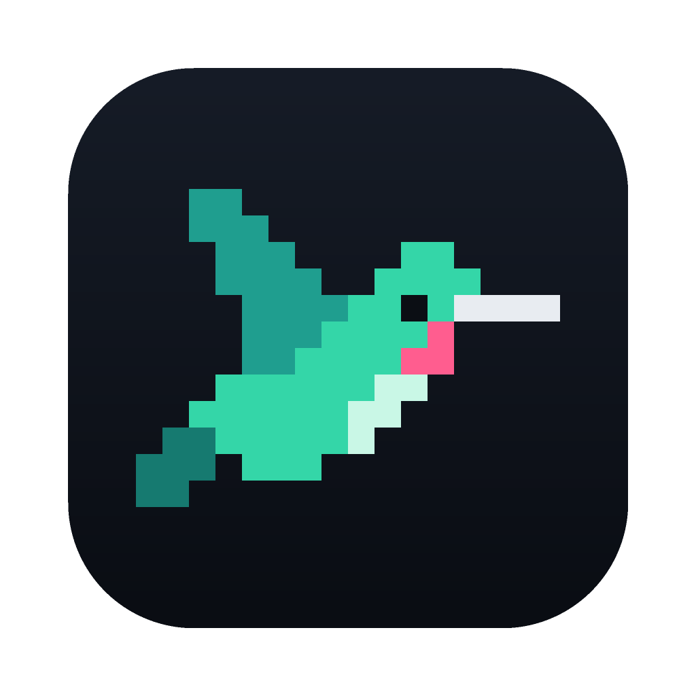

<p align="center">
  
</p>

<h1 align="center">Colibrí</h1>

<p align="center">
  Una terminal para macOS pensada para correr varios agentes de código (Claude Code, Codex, Gemini…)
  en pestañas y saber de un vistazo cuál está trabajando y cuál terminó.
</p>

## Qué tiene

- **Agentes a la vista.** Cada pestaña sabe qué agente corre y si está trabajando. Cuando termina sin que lo hayas visto, la pestaña lleva un punto verde, llega una notificación que te lleva a ella y el icono del Dock cuenta las pendientes. `⌘J` salta a la última que terminó.
- **Panel de agentes** con todos los de todas las ventanas, filtro por estado y buscador (`⌘⇧F`), y botones para abrir los agentes que tengas instalados.
- **Varias ventanas.** Arrastra pestañas entre ellas o fuera para abrir una nueva; `⌘⇧T` reabre lo último que cerraste.
- **Retomar conversaciones.** Al reabrir Colibrí, donde corría Claude Code te ofrece retomar justo esa conversación.
- **Integración con zsh.** Carpeta, rama y archivos cambiados en el prompt como botones, comandos que fallaron marcados con su código y su duración, selección con Shift dentro del comando, historial con `↑` y sugerencias de rutas con Tab.
- **Puertos y procesos.** Paneles para ver qué escucha en cada puerto y qué consume memoria, y detenerlo.
- **Enlaces y rutas** con `⌘` + clic (las rutas se abren en tu editor), carpetas desde Finder y archivos soltados sobre la ventana.
- **Ligera.** Pintor propio en Metal, repinta solo cuando algo cambia y comprime el historial de cada pestaña.
- En **español e inglés**, según el idioma de tu Mac.

## Privacidad

Colibrí no abre conexiones de red propias: no hay telemetría ni comprobación de actualizaciones. La única sonda es una petición HTTP a `127.0.0.1` para saber si un puerto local sirve una web. Ningún programa puede leer tu portapapeles a través de Colibrí.

## Instalación

Requiere macOS 12 o posterior.

### Homebrew

Próximamente, con la primera versión firmada y notarizada.

### Desde el código

Hace falta [Rust](https://rustup.rs) estable (edición 2024) y las herramientas de línea de órdenes de Xcode (`xcode-select --install`).

```sh
git clone https://github.com/jusevasa/colibri.git
cd colibri
scripts/bundle.sh          # compila en release y arma target/Colibri.app
open target/Colibri.app
```

`bundle.sh` firma con tu certificado de Apple si tienes uno en el llavero (Developer ID o Apple Development; `COLIBRI_SIGN_ID` elige otro). Sin ninguno firma «ad-hoc», y macOS volverá a pedir los permisos (carpetas, notificaciones) tras cada compilación. Las notificaciones con clic solo funcionan desde `Colibri.app`, no con `cargo run`.

Cuando el ejecutable cambia en disco (al recompilar), aparece en la barra de pestañas el botón **Actualizar**, que reinicia Colibrí con la versión nueva y reabre las pestañas.

## Uso

| Atajo | Acción |
| --- | --- |
| `⌘T` / `⌘W` | Nueva pestaña / cerrar pestaña |
| `⌘N` | Nueva ventana |
| `⌘⇧T` | Reabrir lo último que se cerró |
| `⌘P` | Paleta de comandos |
| `⌘,` | Preferencias |
| `⌘J` | Ir al agente que terminó |
| `⌘⇧A` / `⌘⇧F` | Panel de agentes / buscar agentes |
| `⌘⇧P` / `⌘⇧M` | Puertos / procesos |
| `⌃⌥⌘J` | Desde cualquier app: traer Colibrí y saltar al agente que terminó |

Todos los atajos se cambian en `~/.config/colibri/config.toml` (`⌘⇧,` lo abre). El archivo se recarga solo al guardarlo.

## Contribuir

Las contribuciones son bienvenidas, también las hechas con agentes. Lee [CONTRIBUTING.md](CONTRIBUTING.md) para preparar el entorno y enviar un PR. Las reglas del repositorio y la arquitectura están en [AGENTS.md](AGENTS.md), que es también lo que leen los agentes de código al trabajar aquí.

## Licencia

Colibrí se publica bajo la [licencia Apache 2.0](LICENSE).

Incluye código de terceros con sus propias licencias:

- [`alacritty_terminal`](https://github.com/alacritty/alacritty), Apache 2.0, en `vendor/alacritty_terminal` con cambios propios marcados con «Colibrí:».
- La fuente [Hack](https://github.com/source-foundry/Hack), en `assets/fonts` ([licencia](assets/fonts/Hack-LICENSE.md)).
- Las dependencias de crates.io que lista `Cargo.toml`, cada una con la suya.
